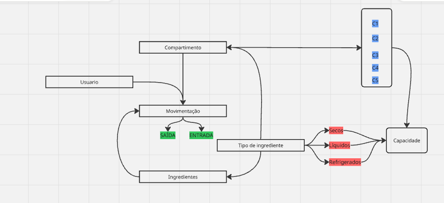
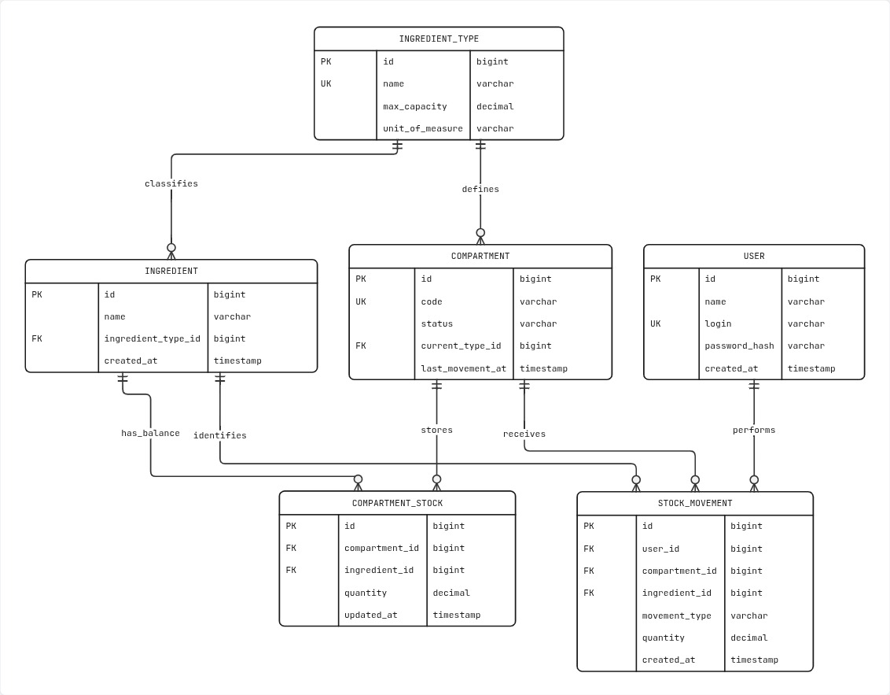
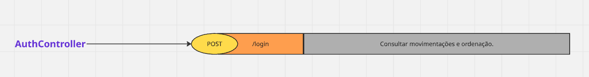
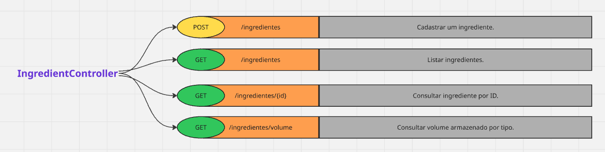
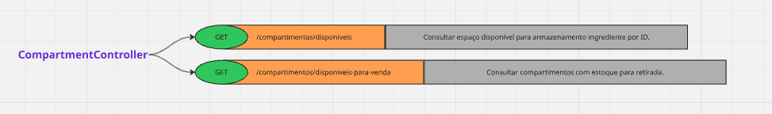
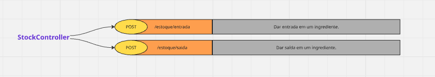
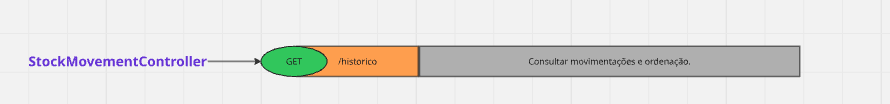

# Warehouse Management

API REST desenvolvida em Java e Spring Boot para gerenciar ingredientes, estoque e compartimentos de um armazém.

## Documentação das rotas

**Comece pela [referência da API](docs/api.md)** para consultar o payload e a resposta de cada rota, os campos obrigatórios, os valores aceitos e os códigos de erro.

- [Autenticação e JWT](docs/api.md#autenticação)
- [Cadastro e consulta de ingredientes](docs/api.md#ingredientes)
- [Consulta detalhada do estoque atual](docs/api.md#get-estoque)
- [Entradas e saídas de estoque](docs/api.md#estoque)
- [Disponibilidade de compartimentos](docs/api.md#compartimentos)
- [Paginação e ordenação do histórico](docs/api.md#paginação-e-ordenação)

Para executar as requisições com exemplos preenchidos, use a [coleção Postman](#postman).

## Pré-requisitos

- **Git** para clonar o repositório.
- **JDK 21** para compilar e executar o backend.
- **Docker** para executar o PostgreSQL 17 em um contêiner.
- **Docker Compose** com o comando `docker compose` para iniciar o banco com a configuração do projeto.

## Como executar a aplicação

1. Clone a branch `develop`, que contém a entrega, e entre na pasta do projeto.

   ```sh
   git clone --branch develop https://github.com/Incivius/warehouse-management.git
   cd warehouse-management
   ```

2. Na raiz do repositório, copie o arquivo de configuração.

   **Linux**

   ```sh
   cp .env.example .env
   ```

   **Windows (PowerShell)**

   ```powershell
   Copy-Item .env.example .env
   ```

   O `.env.example` já vem preenchido para execução local. Basta copiá-lo na primeira configuração. A senha do banco, a chave JWT e as credenciais iniciais da API são públicas e exclusivas para avaliação local. O Git ignora o arquivo `.env`.

3. Na raiz, inicie o PostgreSQL. Se a porta configurada em `DB_PORT` estiver ocupada, ajuste o valor no `.env` antes de subir o banco. O Compose e o Spring Boot usam essa mesma porta.

   ```sh
   docker compose up -d postgres
   ```

4. Verifique se o PostgreSQL já está aceitando conexões.

   **Linux**

   ```sh
   docker compose exec postgres sh -c 'pg_isready -h 127.0.0.1 -U "$POSTGRES_USER" -d "$POSTGRES_DB"'
   ```

   **Windows (PowerShell)**

   ```powershell
   docker compose exec postgres pg_isready -h 127.0.0.1
   ```

   Se a mensagem `accepting connections` ainda não aparecer, aguarde alguns segundos e repita a verificação.

5. Entre em `backend` e inicie o Spring Boot com o Maven Wrapper.

   **Linux**

   ```sh
   cd backend
   ./mvnw spring-boot:run
   ```

   **Windows (PowerShell)**

   ```powershell
   cd backend
   .\mvnw.cmd spring-boot:run
   ```

   Na inicialização, o Flyway executa automaticamente as migrations pendentes. Em um banco novo, elas criam o esquema e inserem os tipos de ingredientes, os cinco compartimentos e os usuários iniciais.

6. A API fica disponível em `http://localhost:8080`.

## Primeiro acesso

- **Login** `admin`
- **Senha** `admin123`

Para entrar, execute **Login (salva JWT automaticamente)** na [coleção Postman](#postman). Se usar outro cliente HTTP, veja o corpo e a resposta de `POST /auth/login` na [referência da API](docs/api.md).

A resposta traz o JWT em `accessToken`. Envie o cabeçalho `Authorization: Bearer <accessToken>` nas demais rotas. O campo `expiresIn` indica a validade em segundos, com padrão de 3.600 segundos. Faça login novamente quando o token expirar.

## Visão geral do projeto

- Cadastro e consulta de ingredientes, com reaproveitamento por nome e tipo e lançamento opcional de estoque pela rota de cadastro.
- Entradas e saídas em cinco compartimentos, com controle de capacidade e compatibilidade por tipo.
- Consultas de saldo por tipo, espaço para armazenamento e estoque para retirada.
- Visão do estoque atual por compartimento, com saldos por ingrediente, capacidade livre e percentual de ocupação.
- Histórico paginado de movimentações com identificação do responsável.

## Arquitetura

A API usa um backend Spring Boot com PostgreSQL. O modelo conceitual mostra como ingredientes, compartimentos e responsáveis se relacionam. O modelo relacional mostra onde ficam o saldo atual e o histórico.

<p align="center">
  
  <br>
  <em>Modelo conceitual do armazém e das movimentações.</em>
</p>

<p align="center">
  
  <br>
  <em>Modelo relacional. A entidade USER da figura corresponde à tabela app_user no PostgreSQL.</em>
</p>

<details>
<summary>Diagramas dos controllers da API</summary>

<p align="center">
  
  <br>
  <em>A rota completa é POST /auth/login. Ela autentica o usuário e emite um JWT.</em>
</p>

<p align="center">
  
  <br>
  <em>Cadastro, listagem, consulta por ID e volume total por tipo.</em>
</p>

<p align="center">
  
  <br>
  <em>A disponibilidade para armazenamento é consultada por tipo e quantidade. A consulta para retirada recebe o tipo.</em>
</p>

<p align="center">
  
  <br>
  <em>Entradas e saídas de estoque.</em>
</p>

<p align="center">
  
  <br>
  <em>A rota GET /historico pertence ao StockHistoryController e lista as movimentações com ordenação e paginação.</em>
</p>

</details>

- [Arquitetura completa](docs/architecture/architecture.md)
- [Quadro do Miro com os detalhes das decisões do projeto](https://miro.com/app/board/uXjVLEpIy58=/?share_link_id=658227767809)

## Documentação complementar

1. [Requisitos do desafio e regras de negócio](docs/requirements.md)
2. [Execução e organização dos testes](docs/testing.md)

## Postman

1. Importe a [coleção Warehouse Management](postman/warehouse-management.postman_collection.json) e o [ambiente local](postman/warehouse-local.postman_environment.json).
2. Selecione o ambiente **Warehouse - Local** e execute **Login (salva JWT automaticamente)**. O ambiente já contém as credenciais públicas de avaliação e a requisição salva o JWT na variável `token`.
3. Execute **Cadastrar ingrediente (sem estoque inicial)** para preencher `ingredientId`. Repita a chamada para conferir que ela retorna `200 OK` com o mesmo ID.
4. Execute **Registrar entrada automática pelo cadastro** e **Consultar estoque atual por compartimento** para verificar o destino e o saldo. Ajuste `registrationQuantity` no ambiente para mudar a quantidade da entrada.
5. Para testar a movimentação com destino explícito, execute **Entrada de estoque** e **Saída de estoque**, nessa ordem. Os exemplos usam C1 (`compartmentId=1`) e dependem da capacidade e do saldo disponíveis.
