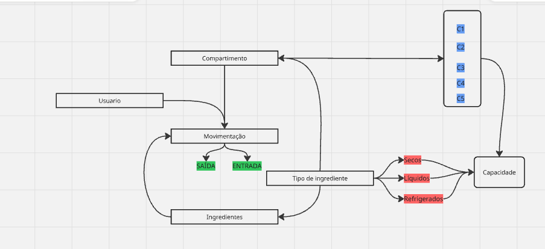
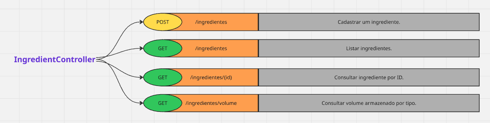
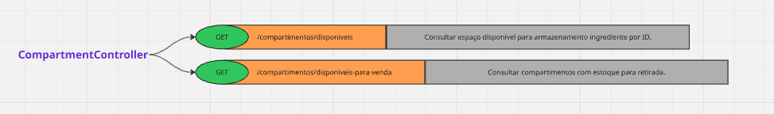
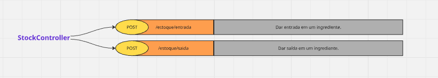
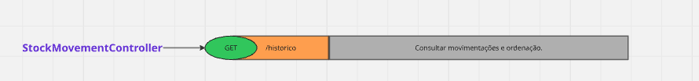
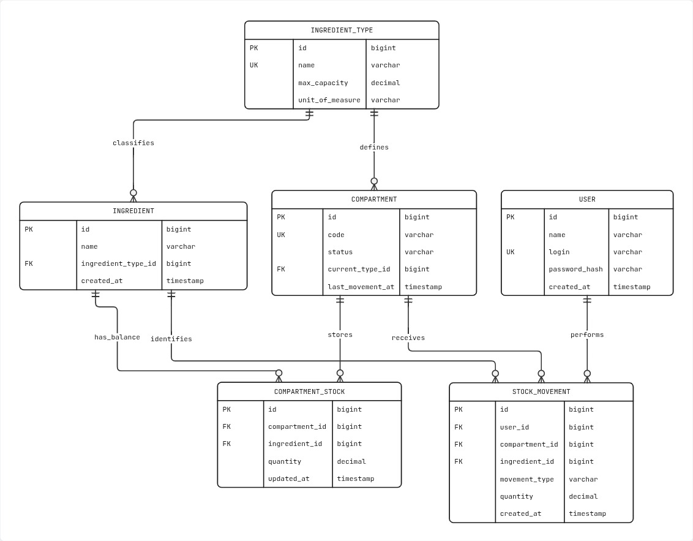
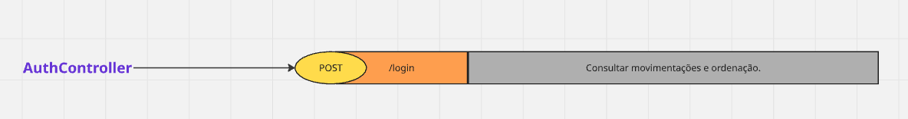

# Arquitetura

A aplicação é uma API REST em um único backend, com PostgreSQL como banco relacional.

## Modelo conceitual

  
   
  <em>Relação entre o responsável, as movimentações e a capacidade de cada compartimento por tipo de ingrediente.</em>

## Tecnologias

| Tecnologia | Uso |
| --- | --- |
| Java 21 e Spring Boot 4.1.2 | Execução da aplicação, configuração e injeção de dependências. |
| Spring MVC, Jackson e Jakarta Validation | Rotas HTTP, serialização JSON e validação de entrada. |
| Spring Data JPA e Hibernate | Mapeamento das entidades, consultas e transações. |
| PostgreSQL 17 e Flyway | Persistência, restrições relacionais e migrations versionadas. |
| Spring Security, BCrypt e JJWT 0.12.6 | Autenticação, verificação de senhas e emissão e validação do JWT. |
| Maven Wrapper e Docker Compose | Build com Maven 3.9.16 e execução local do PostgreSQL. |

## Camadas e pacotes

| Pacote | Responsabilidade |
| --- | --- |
| `controller` e `dto` | Mapeiam as rotas, validam os dados recebidos e definem os contratos JSON. |
| `service` | Orquestra cadastro, disponibilidade, movimentação, histórico e login. Aplica regras do domínio e define limites transacionais. |
| `repository` | Fornece acesso aos dados, projeções, agregações e a consulta que bloqueia o compartimento. |
| `entity` e `enums` | Mapeiam as tabelas e os valores de estado, operação e unidade. |
| `config`, `security` e `exception` | Configuram a cadeia de segurança, estabelecem a identidade da requisição e produzem respostas de erro. |

### Cadastro e consulta de ingredientes

O `IngredientController` expõe cadastro, listagem, consulta por ID e total armazenado por tipo. Os contratos das demais consultas estão na [referência da API](../api.md).

  
   
  <em>Rotas atendidas pelo IngredientController.</em>

### Disponibilidade de compartimentos

O `CompartmentController` consulta a capacidade livre para armazenamento e o saldo disponível para retirada.

  
   
  <em>A disponibilidade para armazenamento é consultada por tipo e quantidade. A consulta para retirada recebe o tipo.</em>

## Movimentação de estoque

  
   
  <em>Rotas de entrada e saída que acionam o StockService.</em>

1. O filtro JWT identifica o usuário e o controller valida o DTO.
2. O `StockService` abre a transação e obtém o compartimento com bloqueio de escrita por meio de `CompartmentService` e `CompartmentRepository`.
3. Na entrada, verifica estado, compatibilidade temporal e capacidade livre. Na saída, verifica estado e saldo do ingrediente. O responsável vem do contexto de segurança.
4. A transação grava o saldo, o estado do compartimento e o histórico. Uma falha reverte o conjunto. No cadastro com entrada inicial, `IngredientService` envolve também a criação do ingrediente na mesma transação.

O bloqueio pessimista na linha do compartimento serializa movimentações concorrentes no mesmo compartimento. A disponibilidade para armazenamento é uma leitura do saldo naquele momento. Uma entrada posterior volta a validar a capacidade sob bloqueio.

### Histórico de movimentações

  
   
  <em>A rota GET /historico pertence ao StockHistoryController e lista as movimentações com ordenação e paginação.</em>

## Persistência

  
   
  <em>Modelo relacional do estoque. A entidade USER da figura corresponde à tabela app_user na migration V1.</em>

O campo `compartment.current_type_id` pode ser nulo enquanto o compartimento ainda não recebeu um tipo.

- `ingredient_type` guarda tipo, capacidade e unidade. Cada `ingredient` referencia um tipo.
- `compartment` guarda código, estado, tipo atual ou último tipo e o horário do último esvaziamento.
- `compartment_stock` guarda um saldo por par de compartimento e ingrediente, com quantidade positiva.
- `stock_movement` guarda cada entrada ou saída e referencia ingrediente, compartimento e o responsável em `app_user`.

O Flyway cria o esquema e insere tipos e compartimentos na V1. A V2 insere os usuários iniciais. O Hibernate valida o esquema na inicialização. O saldo atual fica em `compartment_stock` e o histórico em `stock_movement`. As consultas de totais usam agregações no banco e a consulta paginada do histórico usa `@EntityGraph` para carregar as relações usadas na resposta.

## Autenticação e erros

  
   
  <em>A rota completa é POST /auth/login. Ela autentica o usuário e emite um JWT.</em>

O login usa o `AuthenticationManager`, que carrega a conta pelo login e verifica a senha com BCrypt. O `JwtService` assina um token com chave simétrica configurada no ambiente. O token contém o ID do usuário no assunto, o login, a data de emissão e a expiração.

A segurança é stateless. Em uma rota protegida, o filtro valida o Bearer token, recarrega o usuário pelo ID e preenche o contexto de segurança. A política de acesso exige autenticação para as operações, com as mesmas permissões para os usuários autenticados.

O `GlobalExceptionHandler` converte falhas de validação e de negócio em respostas `ErrorResponse` e retorna `500 INTERNAL_ERROR` para exceções inesperadas tratadas no MVC. O `CustomAuthenticationEntryPoint` usa o mesmo formato para o `401 UNAUTHORIZED` da cadeia de segurança. Os códigos por rota estão na [referência da API](../api.md).
